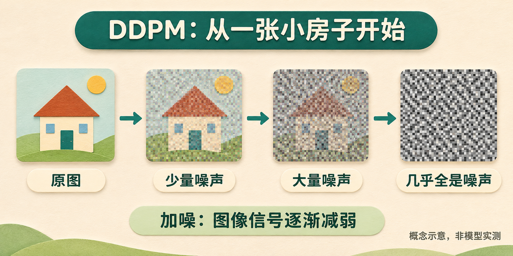
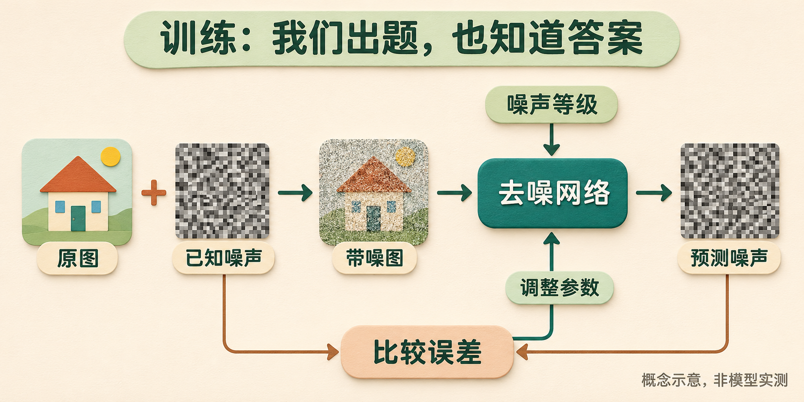
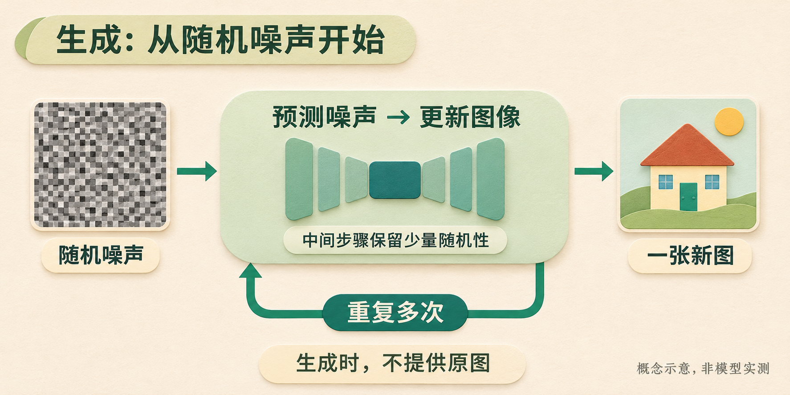

<strong>实时视频生成 · 从零开始</strong> 第 01 课　/　先懂图像，再学视频

# DDPM：一张满是噪点的图，怎么变成小房子？

有时候看 AI 画图，会看到这样的过程：起初是一团杂点，过一会儿出现轮廓，最后成了一幅像样的图片。

这很容易让人觉得：**模型是不是知道噪点下面藏着什么，只要擦干净就行了？**

其实，生成开始时，下面并没有藏着一张完整的画。DDPM 要做的，是利用从大量图片中学到的规律，一步步生成一张新图。

这篇笔记就从这里讲起。不需要先懂概率论，也不用一上来记符号。先顺着小房子的例子看，遇到想深究的地方，再展开公式。

<a href="#start">先看直觉</a> · <a href="#train">它怎么学</a> · <a href="#generate">它怎么画</a> · <a href="#math">再看公式</a> · <a href="#dmd">走向 DMD</a>

> [!NOTE]
> **这篇读完，能说清三件事就够了**：噪声怎么加，网络学什么，生成为什么要分很多步。插画由生图模型重绘，用来解释流程，不是 DDPM 模型运行结果。

---

## 01　先做一件容易的事：把图片弄乱

假设手里有一张小房子的图片。电脑里的图片，本质上是一大堆数字：每个像素的红、绿、蓝分别有多亮，都由数字表示。

现在给这些数字加一些随机扰动。有的像素变亮，有的变暗，图片上就出现了杂点。这些杂点就是这里说的**噪声**。

只加一点，还能看清屋顶和窗户。再加一些，轮廓开始模糊。不断重复，最后就很难看出房子了。

DDPM 采用的是高斯噪声：多数扰动比较小，特别大的扰动比较少，而且亮、暗两个方向都有可能。你暂时不用记住“高斯”怎么计算，知道它是一种有明确规则的随机噪声就好。

但还有一个细节：**每次加噪时，原来的图像信号也会稍微减弱。** 因此过程不是一直往原图上堆杂点，而是让图像的影响越来越小，噪声的影响越来越大。

这叫“前向扩散”。名字听起来复杂，做的事情就是按规定把图一步步弄乱，不需要神经网络参与。

> **停一下想想**：把图弄乱，我们随时能做。可反过来，看到一张很乱的图，怎么知道哪些是房子，哪些是杂点？这才是需要学习的部分。

## 02　让网络做练习：这张图里，加进了什么噪声？

训练的时候，我们的条件很好：**原图在手，噪声也是自己加的。** 所以既能出题，也知道答案。

每道练习题这样出：

1. 选一张图片，比如这张小房子。
2. 随机决定难度：这次只弄乱一点，还是弄得几乎看不清？
3. 随机生成一份噪声，把它和图片混合。
4. 把混合后的图片交给网络，让它猜加进了什么噪声。
5. 把预测和真正加入的噪声比较，根据误差调整网络参数。

这次猜不好，就调整；下一次再换图片、换噪声、换难度。经过大量练习，网络逐渐学会在不同程度的混乱中判断图像结构。

注意，网络的“答案”不是一句“这是一栋房子”，也不是一个分数。**它输出的是一整张噪声预测图，每个位置都有对应的数值。**

网络还会收到一个时间步，通常写作 $t$。这里的“时间”不是现实中经过了几秒，而是一个表示噪声等级的编号。就像做题前先告诉它：这道题大概有多难。

### 为什么不直接让它画原图？

也可以采用预测干净图像的方式。只是原始 DDPM 常用的参数化让网络预测噪声，再通过公式换算出原图估计。两种量有明确的转换关系，不必把“预测噪声”理解成唯一可能的设计。

### 它能把每一次噪声都猜对吗？

不能保证。想象两张不同的图片，都被加了很重的噪声，它们可能看起来非常接近。网络只看到带噪结果，没有办法总是唯一确定它来自哪一张原图。

数学上，在平方误差这个评分规则下，最好的预测是“看到这张带噪图后，所有可能噪声的平均估计”。这也是为什么很重的噪声不能靠一次预测就可靠地恢复细节。

<strong>想看代码？一次训练其实就这几行</strong>

~~~python
# 教学伪代码：不是可直接运行的完整训练项目
x0 = 取一批真实图片()
t = 随机选择每张图的噪声等级()
noise = 生成与图片同形状的高斯噪声()

xt = 按等级混合(x0, noise, t)
pred_noise = model(xt, t)
loss = 平均平方误差(pred_noise, noise)

清空旧梯度()
loss.backward()
更新模型参数()
~~~

模型只接收 xt 和 t。原图用于造题，真实噪声用于评分，都不会作为额外答案偷偷输入模型。

“平方误差”就是把每个位置的预测差值平方，再求平均；预测离答案越远，通常扣分越多。反向传播则负责计算参数应怎样调整。

## 03　正式画图时，原图就不在场了

练习结束后，我们不再给它小房子的原图。生成从一张随机噪声图开始。

网络先预测当前图里的噪声。采样程序根据这个预测算出下一步的图，再把新图交给同一个网络。这样一步步走下去，图像中的结构逐渐形成。

你可以暂时把它想成画画时不断修改草稿：先处理很不确定的大致结构，再逐渐落到细节。不过这只是帮助理解的比喻；实际计算是在每一步更新整张图的数值，并没有硬性规定“这一轮画屋顶，下一轮画窗户”。

**生成的目标不是找回某一张训练图片，而是学会生成新的、符合所学图像规律的样本。** 学到的分布决定了它擅长生成什么；仅仅从随机噪声出发，并不能保证想画什么就画什么。按文字指令画图，还需要加入条件信息。

### 为什么要走这么多步？一次画完不行吗？

刚开始几乎全是噪声，可能的图像太多。一次预测得到的“原图估计”可能是许多可能性的折中，并不一定是一张清晰、可信的图。

分很多小步，可以逐渐减少这种不确定性。代价也很直观：**同一个神经网络要被调用很多次，生成就慢了。** 后面要学的 DMD，正是想训练一个能用更少步骤生成图像的学生模型。

### 都在去噪了，为什么中间还要加一点随机噪声？

因为下一步并不只有一个合理答案。DDPM 的每一步是在一组可能结果中抽一个样本，少量随机性让这个过程保留选择空间。

因此，“去噪”不等于每一步只做减法。标准 DDPM 在中间步骤还会加入规定强度的随机噪声，最后一步通常不再加。

> [!IMPORTANT]
> **训练时**：知道原图，知道自己加的噪声，用误差教网络。  
> **生成时**：没有原图，也没有噪声答案，只能依靠训练好的网络反复预测。

## 04　把刚才的故事，翻译成三个公式

到这里再看公式，会轻松一些。先认识三个角色就够了：

| 写法 | 读成什么 |
| --- | --- |
| $x_0$ | 原来的干净图 |
| $x_t$ | 已经被弄乱到第 t 级的图 |
| $\epsilon$ | 我们随机生成的噪声 |

### 第一条：带噪图是怎么来的？

先写成一句大白话：

> 带噪图 = 缩小一点的原图 + 乘上强度的噪声。

数学写法是：

$$
x_t=\sqrt{\bar\alpha_t}\,x_0+\sqrt{1-\bar\alpha_t}\,\epsilon.
$$

先把 $\bar\alpha_t$ 当成一个逐渐从接近 1 降到接近 0 的旋钮。旋钮大，原图影响大；旋钮小，噪声影响大。

比如 $\bar\alpha_t=0.81$ 时，原图前面的系数是 0.9，噪声前面的系数约是 0.436。**这两个系数不是混合百分比，不要求加起来等于 1；它们的平方才相加为 1。**

这条公式还有个很实用的好处：选好一个等级，就能直接造出这个等级的带噪图，不用真的从第一步一路加过来。所以一次训练通常只抽一个等级做练习。

### 第二条：怎么判断网络猜得好不好？

$$
L=\mathbb E\left[\|\epsilon-\epsilon_\theta(x_t,t)\|^2\right].
$$

从里往外读：

- $\epsilon_\theta(x_t,t)$ 是网络猜出的噪声；下标 $\theta$ 代表可学习的参数。
- 与真实噪声 $\epsilon$ 相减，得到预测误差。
- 平方并求和，得到这道题的错误程度。
- $\mathbb E$ 表示把各种图片、噪声和等级下的错误平均起来。

训练就是不断调整参数，让平均错误变小。实际代码中经常连像素维度也求平均，尺度会不同，但这个直觉不变。

### 第三条：知道噪声估计后，怎么估计原图？

把第一条公式移一下项：

$$
\hat x_0=
\frac{x_t-\sqrt{1-\bar\alpha_t}\,\epsilon_\theta(x_t,t)}{\sqrt{\bar\alpha_t}}.
$$

头上的小帽子表示“估计”，不是保证正确的答案。它做两件事：减去估计的噪声，再补偿原图之前被缩小的幅度。

这也说明，网络预测的是噪声，但我们可以把输出转换成原图估计。读 DMD 代码时，你会再次遇到这个转换。

<strong>进阶：旋钮从哪来？为什么系数带平方根？</strong>

DDPM 先规定每一步加入多少噪声。设这个方差为 $\beta_t$，并定义：

$$
\alpha_t=1-\beta_t,\qquad
\bar\alpha_t=\prod_{s=1}^{t}\alpha_s.
$$

单步加噪写作：

$$
x_t=\sqrt{\alpha_t}x_{t-1}+\sqrt{1-\alpha_t}\epsilon_t.
$$

“方差”描述随机波动的大小。给一个随机变量乘以系数 c，它的方差会乘以 c 的平方，所以这里使用平方根控制方差。

展开前两步：

$$
x_2=\sqrt{\alpha_2\alpha_1}x_0+
\sqrt{\alpha_2(1-\alpha_1)}\epsilon_1+
\sqrt{1-\alpha_2}\epsilon_2.
$$

独立高斯噪声相加仍是高斯噪声。后两项的方差相加得到：

$$
\alpha_2(1-\alpha_1)+(1-\alpha_2)=1-\alpha_2\alpha_1.
$$

继续展开，就得到直接采样任意 $x_t$ 的公式。这里合并后的 $\epsilon$ 是累计噪声的等价表示，不是最后一步单独加入的 $\epsilon_t$。

**读论文时注意记号**：本篇沿用 DDPM 的 $\alpha_t$。另一篇论文若直接写 $x_t=a_t x_0+b_t\epsilon$，那么 $a_t$ 对应这里的 $\sqrt{\bar\alpha_t}$，不要只看字母相似就直接替换。

<strong>进阶：生成时每一步究竟怎么算？</strong>

先从标准高斯分布随机生成 $x_T$，再按 $t=T,\ldots,1$ 更新。网络给出噪声预测后，下一步的均值是：

$$
\mu_\theta(x_t,t)=\frac{1}{\sqrt{\alpha_t}}
\left(x_t-\frac{\beta_t}{\sqrt{1-\bar\alpha_t}}\epsilon_\theta(x_t,t)\right).
$$

然后抽取下一步：

$$
x_{t-1}=\mu_\theta(x_t,t)+\sigma_t z,\qquad z\sim\mathcal N(0,I).
$$

最后一步通常令 z 为零。固定方差的一种选择是：

$$
\sigma_t^2=\tilde\beta_t=
\frac{1-\bar\alpha_{t-1}}{1-\bar\alpha_t}\beta_t,
\qquad\bar\alpha_0=1.
$$

它来自已知原图时的高斯后验 $q(x_{t-1}\mid x_t,x_0)$；生成时原图未知，用模型估计来构造反向转移。这里的条件不能省略：只知道带噪图时，真实的反向分布一般并不严格是单个高斯。

~~~python
# 教学伪代码：model 已训练；并非完整可运行项目
x = 随机高斯噪声图()
for t in 从最大等级走到最小等级():
    pred_noise = model(x, t)
    mean = 按上面的公式计算均值(x, pred_noise, t)
    x = mean + 当前规定的标准差(t) * 新的高斯噪声() if t > 1 else mean
~~~

这段循环不更新模型参数，只反复调用同一个网络。简单把随机项全部删掉，也不能直接称为 DDIM；那是另一种有独立推导的采样方法。

## 05　学到这里，离 DMD 还有多远？

你现在知道，DDPM 学会的是在不同噪声等级下预测噪声。这个预测还有一个数学含义：它可以换算成一个方向，告诉我们**怎样轻微改变当前样本，能让它在所学分布下更常见**。

这个方向叫 **score**。名字像“评分”，但它不是给图片打一个分数，而是一整组与像素或 latent 坐标对应的方向。

“在分布下更常见”也不等于“审美上更好”，只是一个概率意义上的判断。先记住这个区别就够了。

DMD 会比较两个这样的方向：一个来自预训练教师，另一个来自专门学习学生生成结果的辅助模型。为什么要相减、相减后怎么更新学生，是下一篇要解决的问题。这一篇不用急着把它们全部吃透。

<strong>进阶：噪声预测与 score 的关系，完整推一遍</strong>

令 $p_t(x_t)$ 表示真实数据加噪后的分布。score 定义为：

$$
s_t(x_t)=\nabla_{x_t}\log p_t(x_t).
$$

对已知 $x_0$ 的加噪高斯分布求导：

$$
\nabla_{x_t}\log q(x_t\mid x_0)
=-\frac{x_t-\sqrt{\bar\alpha_t}x_0}{1-\bar\alpha_t}
=-\frac{\epsilon}{\sqrt{1-\bar\alpha_t}}.
$$

但我们要的是不知道原图时的边缘分布 score。在固定 t、允许交换微分与积分的条件下：

$$
\begin{aligned}
\nabla_{x_t}\log p_t(x_t)
&=\frac{\int p_0(x_0)\nabla_{x_t}q(x_t\mid x_0)\,dx_0}{p_t(x_t)}\\
&=\mathbb E_{x_0\mid x_t,t}[\nabla_{x_t}\log q(x_t\mid x_0)]\\
&=-\frac{\mathbb E[\epsilon\mid x_t,t]}{\sqrt{1-\bar\alpha_t}}.
\end{aligned}
$$

平方误差的理想最优解是条件均值 $\mathbb E[\epsilon\mid x_t,t]$，因此训练好的网络给出近似：

$$
s_\theta(x_t,t)\approx-\frac{\epsilon_\theta(x_t,t)}{\sqrt{1-\bar\alpha_t}}.
$$

用真实数据训练，就估计真实数据加噪后的 score；用学生生成的样本训练，就估计学生分布加噪后的 score。DMD 中的 fake 模型属于后者，它是辅助去噪器，不是学生生成器本身。

---

## 合上笔记，试着讲给别人听

不用背公式。看看能不能用自己的话回答：

1. 训练网络时，为什么我们知道正确的噪声答案？
2. 生成一张新图时，需要把原图给模型吗？
3. 网络预测的是一张噪声图，还是“房子”这个标签？
4. 为什么一次得到原图估计，不意味着已经能做好一步生成？

如果第三个问题还有点犹豫，回到训练插画再看一遍。如果第四个问题能解释清楚，你已经碰到了后面学习少步蒸馏时最重要的动机。

下一次，我们从“为什么预测噪声可以得到一个方向”继续，接着读 DMD。公式的价值，是让刚才的直觉变得精确；没必要为了记住符号而跳过理解。

<strong>论文出处、阅读状态与本篇的边界</strong>

- 原论文：Jonathan Ho、Ajay Jain、Pieter Abbeel，**Denoising Diffusion Probabilistic Models**，NeurIPS 2020。[论文](https://arxiv.org/abs/2006.11239) · [PDF](https://arxiv.org/pdf/2006.11239) · [官方代码](https://github.com/hojonathanho/diffusion)。
- 公式定位：原文 (4) 为直接加噪，(6)、(7) 为后验，(11)、(12) 为噪声参数化与原图估计，(14) 为简化训练目标；Algorithm 1、2 为训练和采样。
- 理论补充：[Vincent，2011](https://www.iro.umontreal.ca/~vincentp/Publications/DenoisingScoreMatching_NeuralComp2011.pdf)，解释去噪与 score matching 的联系。
- 后续阅读：[DMD，CVPR 2024](https://arxiv.org/abs/2311.18828)。原版 DMD 除分布匹配外还使用回归损失；本篇仅作衔接。
- 本篇是入门解释。平方误差是 DDPM 的简化训练目标，并不与原始负 ELBO 完全相同；完整变分推导尚待补充。
- 插画中的杂点是概念示意，不是高斯扩散实验；右侧小房子不是模型生成结果。当前插画由内置生图模型在初版示意图基础上重绘，属于概念插画。初版矢量图、[绘图源文件](../assets/ddpm/build-illustrations.mjs)及[重绘提示词](../assets/ddpm/render-prompts.json)均保留。
- 教学代码未运行；尚未完成逐行源码阅读、训练复现或速度测试。DDPM 原论文主要研究图像，不据此声称实时视频效果。
- 初稿与本次改写：2026-11-16。当前状态：入门笔记，持续修订。

<a href="../README.md">返回笔记首页</a> · <a href="../LEARNING-PLAN.md">查看学习路线</a>

